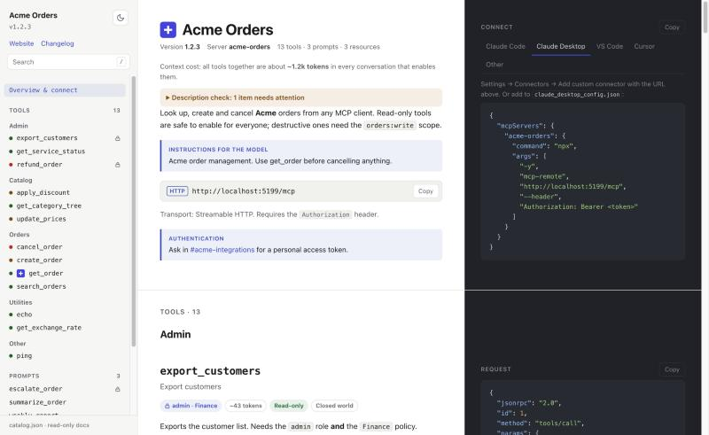

# Hlibz.McpDocs.AspNetCore

A read-only, ReDoc-style documentation page for MCP servers hosted in ASP.NET Core.
Shows what the server offers (tools, prompts, resources) and how to connect to it.



> Status: early (0.1.0). Targets `net8.0`, which also runs in net9 and net10 apps.

```bash
dotnet add package Hlibz.McpDocs.AspNetCore
```

```bash
dotnet run --project samples/Sample.McpServer --launch-profile http
```

Then open http://localhost:5168/mcp-docs/ (raw data: http://localhost:5168/mcp-docs/catalog.json).

## Usage

```csharp
builder.Services.AddMcpServer(...).WithHttpTransport().WithToolsFromAssembly()...;

app.MapMcp("/mcp");
app.MapMcpDocs("/mcp-docs", o =>
{
    o.Description = "What this server is for, **Markdown** subset.";
    o.AuthHeader = "Authorization";    // optional: adds the header to the snippets
    o.AuthHint = "Where to get a token.";
})
.RequireAuthorization();               // RouteGroupBuilder: covers page, catalog.json and assets
```

Group tools with `[McpDocsGroup("Orders")]` on the tool class or method.

## Options

All optional. Set them in the `MapMcpDocs` callback.

| Option | Default | What it does |
|---|---|---|
| `Title` | server title or name | Page title. |
| `Description` | server instructions | Intro under the title (Markdown subset). |
| `McpEndpoint` | found from `MapMcp` | Path or absolute URL used in the connect snippets. A path that matches no mapped route stops startup. |
| `ServerKey` | server name | Key in the generated client configs, e.g. `acme-orders`. |
| `AuthHeader` | none | Adds this header, with `AuthPlaceholder`, to the snippets. |
| `AuthPlaceholder` | `Bearer <token>` | Placeholder value for `AuthHeader`. |
| `AuthHint` | none | How to get credentials (Markdown subset). |
| `ToolGroup` | `McpDocsGrouping.ByAttribute` | Sidebar group per tool; also `ByNamePrefix`, `None`, or your own function. |
| `ShowMeta` | `false` | Show each primitive's `_meta`; when off it is also left out of `catalog.json`. |
| `CheckDescriptions` | `true` | Flag missing descriptions and annotations on the page and as startup warnings. |
| `DefaultColorMode` | `System` | Colour mode for first-time viewers (`System`, `Light`, `Dark`). |
| `PrimaryColor` | built-in | Accent colour: hex, `rgb()`, `hsl()` or a name. Validated at startup. |
| `DarkModePrimaryColor` | `PrimaryColor` | Accent colour in dark mode. |
| `DarkPreset` | `Default` | `Midnight`, `Nord` or `GitHubDark`. |
| `AdditionalCss` | none | Appended after the built-in CSS, served as `_assets/theme.css`. |
| `Favicon` | server icon | `https:` URL, `data:image/` URI or path (`~/` = `PathBase`). |
| `AddToolbarItem(label, url, newTab)` | none | Link in the sidebar; `http(s)://`, `/path` or `~/path`. |
| `PrintStyles` | `true` | Print light and plain, without the sidebar. |

## Authorization

`[Authorize]` on tools, prompts and resources is honoured the way the SDK's `AddAuthorizationFilters()` honours it
for `tools/list` etc.: a viewer only sees the primitives their MCP client would see. Same rules — any
`[AllowAnonymous]` on the class or method wins; otherwise `IAuthorizeData`, `AuthorizationPolicy` and
`IAuthorizationRequirementData` metadata are combined into one policy and evaluated with `IAuthorizationService`
against `HttpContext.User`. Gated primitives the viewer *can* see get a lock badge naming the roles / policies.

Two differences from the MCP endpoint, both inherent to a page opened in a browser:

- **Identity is the browser's.** The docs request is authenticated by whatever the app's default scheme sees on
  it (usually a cookie), while MCP clients typically send a bearer token. If the browser isn't signed in, the page
  shows the anonymous view.
- **The authorization resource is the `HttpContext`**, not the SDK's MCP request context. Resource-based
  handlers that look for the MCP context won't match here, and the primitive stays hidden.

`catalog.json` is served `private, no-cache`; the ETag still hashes the content, so viewers with the same
access share a cached build and get 304s.

The sample signs in with a demo cookie: `/demo/sign-in?roles=admin,finance`, `/demo/sign-out`.

## Troubleshooting

| Symptom | Cause | Fix |
|---|---|---|
| App exits at startup, critical log about `McpEndpoint` | The configured path matches no `MapMcp` route. | Fix the path, or remove `McpEndpoint` to use the discovered one. |
| Warning: MCP endpoint requires authorization but the docs page doesn't | The page publishes the whole surface to anyone. | Add `.RequireAuthorization()` to `MapMcpDocs`, or accept it. |
| Page shows fewer tools than `tools/list` | `[Authorize]` filtering uses the browser's identity (usually a cookie), not your MCP token; or the server uses a custom `ListToolsHandler`. | Sign in in the browser; custom handlers aren't visible to the page. |
| Connect snippets show the wrong URL behind a proxy | `PathBase` or host differs from what the browser sees. | Set `McpEndpoint` to the public URL. |
| Page is blank, console shows CSP errors | Your own CSP header replaced ours (an existing one is never overwritten). | Allow `script-src 'self'; style-src 'self'; img-src 'self' data: https:` for the docs path. |
| Icon doesn't show | Only `https:` and `data:image/` icons are used. | Serve the icon over https or inline it. |
| `ArgumentException` mentioning `PrimaryColor` / `Favicon` | The value isn't a plain colour / safe URL. | Use a hex, `rgb()`, `hsl()` or named colour; an `https:`, `data:image/` or path favicon. |
| Startup warnings "No description" | `CheckDescriptions` found gaps. | Add descriptions and annotations, or set `CheckDescriptions = false`. |

## What this doesn't do

- **Call anything.** It's a read-only page: no "try it", no credentials entered in the browser.
- **Hide the page by environment.** Map it only where you want it; there's no `IsDevelopment()` switch.
- **Show dynamic servers.** Primitives created by a custom `ListToolsHandler` or list filters aren't visible; only what's registered, filtered by `[Authorize]`.
- **Run custom HTML or script.** Toolbar items are links, `AdditionalCss` is CSS; the CSP stays strict.
- **Render full CommonMark.** Markdown is a small safe subset.
- **Mark which arguments support completion.** The SDK has one `CompleteHandler`, nothing per argument.

## Tests

```bash
dotnet test
```

`tests/` runs a real server on `TestServer`: it asserts that `catalog.json` equals what an MCP client gets from
`tools/list`, `prompts/list`, `resources/list` and `resources/templates/list` (anonymous and signed in), the status
codes anonymous callers get on protected docs, the CSP rules, option validation, `PathBase` handling and endpoint
discovery. CI (`.github/workflows/ci.yml`) builds, tests and packs; a `v*` tag pushes to NuGet (needs a
`NUGET_API_KEY` secret). Visual regression tests are not written.

## Layout

```
src/Hlibz.McpDocs.AspNetCore/
  McpDocsOptions.cs                          options, [McpDocsGroup], grouping strategies
  McpDocsCatalog.cs                          catalog.json from McpServerOptions collections, per viewer
  McpDocsAuthorization.cs                    [Authorize] evaluation, mirrors the SDK's list filters
  McpDocsEndpointRouteBuilderExtensions.cs   MapMcpDocs: page, catalog.json, _assets/*
  McpDocsEndpointDiscovery.cs                finds the MapMcp route, startup checks
  McpDocsTheme.cs                            theme.css from the options, value validation
  McpDocsQuality.cs                          description checks
  Assets/index.html, app.css, print.css, app.js   embedded UI (vanilla JS, no deps, no inline script)
samples/Sample.McpServer/                    13 tools (incl. runtime-registered `ping`, recursive output,
                                             dictionary input, polymorphic anyOf, [Authorize]d admin tools),
                                             3 prompts, 2 resources, 1 template; demo cookie sign-in
```

## What the proof of concept answered

- **Data source works.** `IOptions<McpServerOptions>.Value.ToolCollection / PromptCollection / ResourceCollection`
  are populated for both attribute-based and runtime-registered (`McpServerTool.Create`) primitives. Serializing
  `ProtocolTool` etc. with `McpJsonUtilities.DefaultOptions` gives output **identical** to live `tools/list`,
  `prompts/list`, `resources/list` and `resources/templates/list` (checked by diffing all four).
- **No declaring type for grouping.** `AIFunctionMcpServerTool` (which has the `MethodInfo`) is internal, and
  `Metadata` holds attribute *instances* only. So grouping reads our own `[McpDocsGroup]` from `Metadata` (class attributes
  come before method attributes, so the method one wins). Runtime tools land in "Other".
- **Schema renderer is most of the UI work, and doable.** ~250 lines cover nested objects, arrays, maps
  (`additionalProperties`), `$ref` incl. the SDK's root-recursive `"$ref": "#"`, `anyOf`/`oneOf` variants,
  nullable via type arrays, enum/const/default/min/max/pattern chips, and example generation for the right panel.
- **Serving:** `catalog.json` cached per `PathBase` and set of visible primitives, ETag = SHA-256 of content → 304s; assets
  `immutable` with a content-hash `?v=`; page CSP `script-src 'self'; style-src 'self'` holds (nothing inline);
  `RequestDelegate` endpoints, so the library builds with `IsAotCompatible` and no trim warnings.

## Page

- Overview: title, version, description, model instructions, endpoint with copy, auth note.
- Connect panel: Claude Code / Claude Desktop / VS Code / Cursor / Other, generated from endpoint + auth header.
- Sidebar: grouped tools with risk dots (green read-only, amber modifies, red destructive), prompts, resources;
  search (`/` to focus); scroll spy; deep links `#tool/<name>`.
- Tool: annotation badges with spec defaults applied, parameters tree, result tree (when `outputSchema`),
  example `tools/call` request and response.
- Light/dark: system default (or `DefaultColorMode`), toggle remembered in `localStorage`.
- Keyboard: `/` focuses search, arrow keys move through the sidebar and the connect tabs, skip link, visible focus.

## Not done / open

- Visual regression tests (Playwright).
- Markdown is a small safe subset, not CommonMark.
- Connect snippet formats are from memory — verify against current client docs before shipping.
