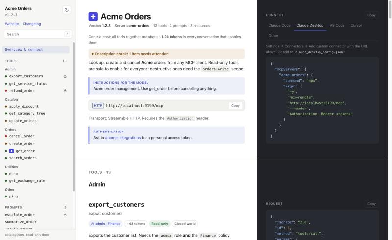

# Hlibz.McpDocs.AspNetCore

**A ReDoc-style documentation page for an MCP server hosted in ASP.NET Core.** It shows
what the server offers (tools, prompts, resources) and how to connect to it, from the registrations
the MCP SDK already has, with nothing to write twice. Turn on the try-it console and readers can call
them from the page too.

[](https://github.com/hlib-zinchenko/Hlibz.McpDocs.AspNetCore/actions/workflows/ci.yml)
[](https://www.nuget.org/packages/Hlibz.McpDocs.AspNetCore)
[](https://www.nuget.org/packages/Hlibz.McpDocs.AspNetCore)
[](https://github.com/hlib-zinchenko/Hlibz.McpDocs.AspNetCore/blob/main/LICENSE)



```csharp
app.MapMcp("/mcp");
app.MapMcpDocs("/mcp-docs");   // that's the whole zero-config path
```

- **Every tool, prompt, resource and template**, with parameter and result trees (recursive, `anyOf`,
  maps and enums included), annotation badges, and an example request and response you can fold.
- **Connect snippets** for Claude Code, Claude Desktop, VS Code, Cursor and Goose, with
  one-click "Add to VS Code" and "Add to Cursor" buttons.
- **Documents everything, like OpenAPI docs.** `[Authorize]`d primitives are listed with a lock badge naming the
  roles and policies they need; the endpoint still refuses callers without them. Or filter them per viewer.
- **Try it** (opt-in): call a tool, get a prompt or read a resource from the page with a bearer token, and see
  the content blocks, messages or contents that come back. See [Try it](#try-it).
- **Exports for agents:** `catalog.json`, `catalog.md`, `llms.txt`, and a `server.json` for the MCP Registry.
- **A static page too:** the same page as one HTML file, for GitHub Pages, readers who can't reach the app, or a stdio server.
- **Checks your descriptions.** Missing descriptions and annotations are flagged on the page and logged at startup.
- **Strict by default:** no inline script or style, a CSP that an existing one of yours always wins over.
- Dark and light themes, accent colour, print styles, keyboard navigation.

## Why

An MCP client sees your server through `tools/list`, which is fine for a model and no use to the
person deciding whether to connect to it. A hand-written page drifts the first time someone renames
a parameter. This page is generated from the same registrations `tools/list` is, serialized with the
SDK's own JSON options, so what it shows is what a client gets. A test in this repo diffs the two.

## About this project

This started as a companion to an MCP server I build at work. I wanted a page that shows, at a glance,
what our MCP server can do, so that I, my colleagues or a client can see it without reading code or
poking `tools/list` by hand. The project grows as I discover more of MCP, so expect it to change and pick up
new features over time.

If you hit a problem or have an idea, please [open an issue](https://github.com/hlib-zinchenko/Hlibz.McpDocs.AspNetCore/issues).
I'll do my best to keep the project moving.

## Install

```bash
dotnet add package Hlibz.McpDocs.AspNetCore --prerelease
```

With central package management, set the version in `Directory.Packages.props`:

```xml
<PackageVersion Include="Hlibz.McpDocs.AspNetCore" Version="0.2.0-preview.2" />
```

## Quick start

```csharp
builder.Services.AddMcpServer(...).WithHttpTransport().WithToolsFromAssembly()...;

app.MapMcp("/mcp");
app.MapMcpDocs("/mcp-docs", o =>
{
    o.Description = "What this server is for, **Markdown** subset.";
    o.AuthHeader = "Authorization";    // optional: adds the header to the snippets
    o.AuthHint = "Where to get a token.";
    o.EnableTryIt();                   // optional: a "Try it" button on each tool, prompt and resource
})
.RequireAuthorization();               // RouteGroupBuilder: covers page, catalog.json and assets
```

Group tools with `[McpDocsGroup("Orders")]` on the tool class or method.

To try it, run the sample and open http://localhost:5168/mcp-docs/:

```bash
dotnet run --project samples/Sample.McpServer --launch-profile http
```

The [sample's README](https://github.com/hlib-zinchenko/Hlibz.McpDocs.AspNetCore/blob/main/samples/Sample.McpServer/README.md)
lists what it offers, which entries need which role, and how to sign in with a demo token or cookie.

## Options

All optional. Set them in the `MapMcpDocs` callback.

| Option | Default | What it does |
|---|---|---|
| `Title` | server title or name | Page title. |
| `Description` | server instructions | Intro under the title (Markdown subset). |
| `McpEndpoint` | found from `MapMcp` | Path or absolute URL used in the connect snippets. A path that matches no mapped route stops the app once it has started. |
| `ServerKey` | server name | Key in the generated client configs, e.g. `acme-orders`. |
| `AuthHeader` | none | Adds this header, with `AuthPlaceholder`, to the snippets. |
| `AuthPlaceholder` | `Bearer <token>` | Placeholder value for `AuthHeader`. |
| `AuthHint` | none | How to get credentials (Markdown subset). |
| `EnableTryIt(configure)` | off | A "Try it" button on each tool, prompt and resource that calls the MCP endpoint from the browser. See [Try it](#try-it). |
| `GatedPrimitives` | `Show` | `[Authorize]`d tools, prompts and resources: `Show` lists them for everyone with what they require; `Hide` lists them only for viewers who pass. See [Authorization](#authorization). |
| `ToolGroup` | `McpDocsGrouping.ByAttribute` | Sidebar group per tool; also `ByNamePrefix`, `None`, or your own function. |
| `HtmlExport` | `true` | A download button beside the theme toggle that saves the page as one HTML file (`{pattern}/docs.html`), as the viewer sees it. See [Static page](#static-page). |
| `InstallLinks` | `true` | "Add to VS Code" / "Add to Cursor" buttons under the connect snippets. They open the editor's own install dialog; with `AuthHeader` set they carry the placeholder token. |
| `RegistryName` | none | Reverse-DNS name (`io.github.acme/orders`); when set, `server.json` for the MCP Registry is served at `{pattern}/server.json` (one `streamable-http` remote, plus the auth header if configured). |
| `ShowMeta` | `false` | Show each primitive's `_meta`; when off it is also left out of `catalog.json`. |
| `CheckDescriptions` | `true` | Flag missing descriptions and annotations on the page and as startup warnings. |
| `DefaultColorMode` | `System` | Colour mode for first-time viewers (`System`, `Light`, `Dark`). The toggle then cycles follow system → the opposite look → the system's look, and remembers the viewer's pick. |
| `PrimaryColor` | built-in | Accent colour: hex, `rgb()`, `hsl()` or a name. Validated at startup. |
| `DarkModePrimaryColor` | `PrimaryColor`, lightened | Accent colour in dark mode and on the code panel. Set it if your brand colour is near-black. |
| `DarkPreset` | `Default` | `Midnight`, `Nord` or `GitHubDark`. |
| `AdditionalCss` | none | Appended after the built-in CSS, served as `_assets/theme.css`. |
| `Favicon` | server icon | `https:` URL, `data:image/` URI or path (`~/` = `PathBase`). |
| `AddToolbarItem(label, url, newTab)` | none | Link in the sidebar; `http(s)://`, `/path` or `~/path`. |
| `PrintStyles` | `true` | Print light and plain, without the sidebar. |

## Exports for agents

Next to `catalog.json`, the same catalog is rendered as:

- `catalog.md`: every tool, prompt and resource as Markdown, with parameter tables, annotations and required roles.
- `llms.txt`: a short index in the [llms.txt](https://llmstxt.org) shape that links to `catalog.md`. It lives under
  the docs path (`/mcp-docs/llms.txt`), not at the site root; serve it from the root yourself if you want that.
- `server.json`: for the MCP Registry, only when `RegistryName` is set.

All three sit in the route group, so `.RequireAuthorization()` covers them and `[Authorize]` filtering applies.
No `.well-known` server card: the proposal is still a draft and its path and shape differ between drafts.

## Static page

The page can be saved as one HTML file: styles, script and catalog inline, nothing fetched, so it also works
opened from disk. Publish it on GitHub Pages, send it to someone who can't reach the app, or document a stdio
server, which has no page to map.

**From the page.** The download button beside the theme toggle saves `{pattern}/docs.html`: the page as shown, with the MCP endpoint, toolbar links and favicon made absolute for the host it was downloaded from. It sits
in the route group, so `.RequireAuthorization()` covers it. Set `HtmlExport = false` to remove the button and the
route.

**From code**, e.g. in CI, with `McpDocsSnapshot.CreateHtmlAsync`:

```csharp
var app = builder.Build();

// dotnet run -- --export-html site/index.html
if (args is ["--export-html", var file])
{
    var html = await McpDocsSnapshot.CreateHtmlAsync(app.Services, ConfigureDocs, mcpEndpoint: "https://api.example.com/mcp");
    await File.WriteAllTextAsync(file, html);
    return;
}

app.MapMcpDocs("/mcp-docs", ConfigureDocs);
```

- **How to connect.** A file has no host to resolve `/mcp` against, so `mcpEndpoint` (or `McpEndpoint` in the
  options) must be an absolute `http(s)` URL. For a stdio server pass the command a client runs instead,
  `stdioCommand: ["dnx", "Acme.Mcp", "--yes"]`, and the connect snippets start it. With neither, the page
  documents the primitives and has no connect panel.
- **Whose view.** With `GatedPrimitives = Hide`, the file shows what `viewer` may see (anonymous by default) to
  everyone who opens it. By default every viewer's file is the same.
- **Stable.** The same server and options give the same bytes, so a checked-in copy changes only when they do.
- **Still strict.** A `<meta>` CSP allows the inline script and styles by their hashes, and nothing else.
- **Links.** Use absolute URLs for toolbar items; a favicon path into the app is dropped in favour of the server
  icon. `catalog.md`, `llms.txt` and `server.json` aren't part of the file.

The sample has the switch above: `dotnet run --project samples/Sample.McpServer -- --export-html site/index.html`.

## Try it

`o.EnableTryIt()` adds a **Try it** button beside each primitive's request sample. It opens a panel with the
arguments prefilled from the schema (a JSON editor for tools, a field per argument for prompts and per variable
for resource templates), a token field, and Send. The answer shows as a tool's content blocks (text, JSON
folded like the samples, images) and `structuredContent`, the messages a prompt expands to, or a resource's
contents, with the raw response one click away. The request it sends is shown too, and copies as `curl`.

```csharp
app.MapMcpDocs("/mcp-docs", o =>
{
    o.AuthHeader = "Authorization";
    o.EnableTryIt(t =>
    {
        t.CredentialStorage = McpDocsTryItCredentialStorage.Session;   // keep the token for the tab
        t.ReadOnlyOnly = true;                                         // only read-only tools get a button
    });
});
```

| Setting | Default | What it does |
|---|---|---|
| `CredentialStorage` | `Memory` | Where the typed token is kept: `Memory` (gone on reload), `Session` (`sessionStorage`, for the tab) or `Local` (`localStorage`). A stored token has a Forget button. |
| `CredentialLifetime` | 8 hours | How long a stored token lasts after it was last typed; `null` keeps it until forgotten. |
| `SendCookies` | `true` | Send the browser's cookies for this origin, so cookie-authenticated endpoints work for a signed-in viewer. `false` sends only the token. |
| `ReadOnlyOnly` | `false` | Only tools annotated `readOnlyHint: true` get a button; prompts and resources always do. A convenience, not access control. |

**How it calls the server.** One `POST` per call, in the stateless Streamable HTTP shape the SDK serves by default
(protocol `2026-07-28`): `MCP-Protocol-Version`, `Mcp-Method` and `Mcp-Name` headers, the protocol fields in
`_meta`, no `initialize` and no session. Parameters marked `[McpHeader]` are mirrored into their `Mcp-Param-*`
headers, and values that aren't plain ASCII go Base64-encoded, as the SDK requires. The console tells the server it
supports nothing (`clientCapabilities: {}`), so a tool that asks for elicitation or sampling shows what it asked
for and stops there.

**The token.** It is sent in `AuthHeader` (`Authorization` when unset). In `Authorization`, a bare token gets
`Bearer ` in front; anything that already has a scheme is sent as typed. A 401 (endpoint-level
`RequireAuthorization()`) shows as "the token is missing or invalid"; a tool refused by `[Authorize]` shows the
server's JSON-RPC error. With the default `GatedPrimitives = Show` every gated primitive is on the page, so
whatever the token may call can be tried. On screen the request shows the scheme, not the token; Copy as curl
includes it. The page's CSP allows no inline or third-party script, which is what keeps an injected script from
reading a stored token.

**Side effects.** MCP tools change things more often than a typical REST operation, and Send calls them for real.
Its colour follows the tool's annotations: the accent for read-only tools, amber for "modifies data", red for
destructive tools and for tools with no annotations (the spec's defaults assume the worst), with a line saying so.
Use `ReadOnlyOnly` for docs in front of a real system.

**Where there's no button.** On a static export (a file can't call the server), for a stdio server, when the MCP
endpoint is on another origin (it answers no CORS preflight, and the page's `connect-src` is `'self'`), and when the
server is `SessionMode = Stateful`, which refuses the stateless shape (`StatefulForInitializeClients` works). The
last two log a warning at startup.

## Authorization

Like OpenAPI docs, the page documents everything the server offers. A tool, prompt or resource gated with
`[Authorize]` is listed for every viewer with a lock badge naming the roles and policies it requires, and
`catalog.md` adds a "Requires:" line. Listing it changes nothing about who may call it: the MCP endpoint
refuses callers who don't pass. The catalog is the same for everyone and no policy is evaluated.

That suits the usual setup: MCP clients send a bearer token, and `/mcp-docs` is opened in a browser that has
none. Endpoint-level auth (`app.MapMcp().RequireAuthorization()`) gates every call and hides nothing, so it
needs nothing here.

Only when a primitive's roles or descriptions are not for everyone who can open the page, either protect the
page (`.RequireAuthorization()` on `MapMcpDocs`) or set `GatedPrimitives = Hide`. A viewer then only sees the
primitives their MCP client would see, the way the SDK's `AddAuthorizationFilters()` filters `tools/list`. Same
rules: any `[AllowAnonymous]` on the class or method wins; otherwise `IAuthorizeData`, `AuthorizationPolicy`
and `IAuthorizationRequirementData` metadata are combined into one policy and evaluated with
`IAuthorizationService` against `HttpContext.User`. With `Hide`, two things differ from the MCP endpoint, both
inherent to a page opened in a browser:

- **Identity is the browser's.** The docs request is authenticated by whatever the app's default scheme sees on
  it (usually a cookie), while MCP clients typically send a bearer token. If the browser isn't signed in, the page
  shows the anonymous view, so gated primitives aren't documented for anyone who only has a token.
- **The authorization resource is the `HttpContext`**, not the SDK's MCP request context. Resource-based
  handlers that look for the MCP context won't match here, and the primitive stays hidden.

`catalog.json` is served `private, no-cache`; the ETag still hashes the content, so viewers with the same
access share a cached build and get 304s.

The sample signs in with a demo cookie (`/demo/sign-in?roles=admin,finance`, `/demo/sign-out`). It makes a
difference with `GatedPrimitives = Hide`, which the sample leaves commented out. Its try-it console takes a demo
bearer token that is simply the roles it grants: type `admin` and `refund_order` succeeds.

## Troubleshooting

| Symptom | Cause | Fix |
|---|---|---|
| App stops right after starting, critical log about `McpEndpoint`; docs requests fail with the same message | The configured path matches no `MapMcp` route. | Fix the path, or remove `McpEndpoint` to use the discovered one. |
| Warning: MCP endpoint requires authorization but the docs page doesn't | The page publishes the whole surface to anyone. | Add `.RequireAuthorization()` to `MapMcpDocs`, or accept it. |
| Page shows fewer tools than `tools/list` | With `GatedPrimitives = Hide`, filtering uses the browser's identity (usually a cookie), not your MCP token; or the server uses a custom `ListToolsHandler`. | Sign in in the browser, or keep the default `Show`; custom handlers aren't visible to the page. |
| No "Try it" button | `EnableTryIt()` isn't called; the server is `Stateful` or the endpoint is an absolute URL on another origin (both logged at startup); the tool isn't read-only and `ReadOnlyOnly` is on; or it's a static export. | See [Try it](#try-it). |
| Try it says the token is missing or invalid | The endpoint answered 401: no token, a wrong one, or one sent in the wrong header. | Paste the token (`Bearer ` is added in `Authorization`), or set `AuthHeader` to the header your server reads. |
| Connect snippets show the wrong URL behind a proxy | `PathBase` or host differs from what the browser sees. | Set `McpEndpoint` to the public URL. |
| Page is blank, console shows CSP errors | Your own CSP header replaced ours (an existing one is never overwritten). | Allow `script-src 'self'; style-src 'self'; img-src 'self' data: https:` for the docs path. |
| Icon doesn't show | Only `https:` and `data:image/` icons are used. | Serve the icon over https or inline it. |
| `ArgumentException` mentioning `PrimaryColor` / `Favicon` | The value isn't a plain colour / safe URL. | Use a hex, `rgb()`, `hsl()` or named colour; an `https:`, `data:image/` or path favicon. |
| Startup warnings "No description" | `CheckDescriptions` found gaps. | Add descriptions and annotations, or set `CheckDescriptions = false`. |

## What this doesn't do (yet)

Mostly not a "never": this is where the project stands today, and much of it may change.

- **Answer a server that asks for input.** The try-it console can't fill in elicitation or sampling requests yet, and
  doesn't call `Stateful` servers. Schema-driven forms for tool arguments may come too; for now it's a JSON editor.
- **Hide the page by environment.** Map it only where you want it; there's no `IsDevelopment()` switch yet.
- **Show dynamic servers.** Primitives created by a custom `ListToolsHandler` or list filters aren't visible; only what's registered, filtered by `[Authorize]`. Hard to solve in general, but I may find a way.
- **Run custom HTML or script.** Toolbar items are links, `AdditionalCss` is CSS; the CSP stays strict. This one is on purpose and likely to stay.
- **Render full CommonMark.** Markdown is a small safe subset for now; it may grow.
- **Mark which arguments support completion.** The SDK has one `CompleteHandler`, nothing per argument, so this depends on the SDK.

## Testing your contract

`McpDocsSnapshot.CreateAsync(app.Services)` returns the catalog as stable, indented JSON without an HTTP
request. Compare it to a checked-in file (or pass it to Verify) and a renamed parameter, a changed output
schema or a dropped `[Authorize]` (its requirements are part of the contract) fails the build, the MCP
equivalent of an OpenAPI diff. With `GatedPrimitives = Hide`, pass `viewer:` to snapshot one role's view:
[`SnapshotTests.cs`](https://github.com/hlib-zinchenko/Hlibz.McpDocs.AspNetCore/blob/main/tests/Hlibz.McpDocs.AspNetCore.Tests/SnapshotTests.cs) does this for an
anonymous and an admin viewer; `UPDATE_SNAPSHOTS=1 dotnet test` accepts a change.

The snapshot is the contract only: definitions, capabilities, instructions and authorization. How the page
presents them (title, links, sidebar groups, description warnings) is left out, so changing those fails
nothing. Pass `includePresentation: true` for the whole catalog the page is built from.

## Compatibility

- Targets `net10.0` and `net11.0`. CI builds and tests on both runtimes.
- Built against `ModelContextProtocol.AspNetCore` 2.3.1 and accepts any 2.x. Authorization mirrors that
  version's `AddAuthorizationFilters()`; a test compares what the page shows each viewer under
  `GatedPrimitives = Hide` with what the server lists them, and a weekly CI job runs it against the newest stable SDK. 3.0 and later are outside
  the range until they've been checked.
- `IsAotCompatible`: endpoints are `RequestDelegate`s, and the library builds with no trim warnings.
- Connect snippets follow the clients' current documentation (VS Code and Cursor install links, Goose
  `config.yaml`). If one stops working after a client update, please open an issue.

## Versioning

The package follows [semantic versioning](https://semver.org). Until 1.0, a minor
version may change an option or the shape of `catalog.json`. `catalog.json`, `catalog.md` and
`llms.txt` are generated output meant for tools and people, so snapshot tests of them are expected to
change when you upgrade; review the diff, then accept it.

## Development

```bash
dotnet build
dotnet test --project tests/Hlibz.McpDocs.AspNetCore.Tests
```

`tests/Hlibz.McpDocs.AspNetCore.Tests` runs a real server on `TestServer`: it asserts that `catalog.json` equals what an MCP client
gets from `tools/list`, `prompts/list`, `resources/list` and `resources/templates/list` (anonymous
and signed in), the status codes anonymous callers get on protected docs, the CSP rules, option
validation, `PathBase` handling, endpoint discovery and the exports.

`tests/Hlibz.McpDocs.AspNetCore.VisualTests` screenshots the page with Playwright (light, dark, mobile, recursive and polymorphic
schemas) against baselines in its `Baselines/<os>/`. Font rendering differs per OS, so only
the macOS baselines are checked in and CI doesn't run it. Install Chromium once, then run:

```bash
dotnet build tests/Hlibz.McpDocs.AspNetCore.VisualTests
tests/Hlibz.McpDocs.AspNetCore.VisualTests/bin/Debug/net10.0/.playwright/node/darwin-arm64/node tests/Hlibz.McpDocs.AspNetCore.VisualTests/bin/Debug/net10.0/.playwright/package/cli.js install chromium
dotnet test --project tests/Hlibz.McpDocs.AspNetCore.VisualTests
```

A missing baseline is written on first run; `UPDATE_SNAPSHOTS=1` accepts changes.

CI ([`ci.yml`](https://github.com/hlib-zinchenko/Hlibz.McpDocs.AspNetCore/blob/main/.github/workflows/ci.yml)) builds, tests and packs, and checks the
package with [`check-package.sh`](https://github.com/hlib-zinchenko/Hlibz.McpDocs.AspNetCore/blob/main/.github/scripts/check-package.sh): README and icon
in the nuspec, and the page assets embedded in the assembly. Pushing a `v*.*.*` tag runs
[`release.yml`](https://github.com/hlib-zinchenko/Hlibz.McpDocs.AspNetCore/blob/main/.github/workflows/release.yml), which runs the same checks and publishes to
NuGet with trusted publishing; the version comes from the tag. [`sdk-latest.yml`](https://github.com/hlib-zinchenko/Hlibz.McpDocs.AspNetCore/blob/main/.github/workflows/sdk-latest.yml)
runs the tests weekly against the newest MCP SDK. Actions are pinned by commit SHA; Dependabot keeps them current.

```
src/Hlibz.McpDocs.AspNetCore/
  McpDocsOptions.cs                          options, [McpDocsGroup], grouping strategies
  McpDocsTryItOptions.cs                     try-it console settings, when it can't run
  McpDocsCatalog.cs                          catalog.json from McpServerOptions collections
  McpDocsAuthorization.cs                    [Authorize] evaluation, mirrors the SDK's list filters
  McpDocsEndpointRouteBuilderExtensions.cs   MapMcpDocs: page, catalog, exports, _assets/*
  McpDocsEndpointDiscovery.cs                finds the MapMcp route, startup checks
  McpDocsExports.cs                          catalog.md, llms.txt, server.json
  McpDocsSnapshot.cs                         public catalog snapshot for tests
  McpDocsTheme.cs                            theme.css from the options, value validation
  McpDocsQuality.cs                          description checks
  Assets/index.html, app.css, print.css, app.js   embedded UI (vanilla JS, no deps, no inline script)
samples/Sample.McpServer/                    13 tools, 3 prompts, 2 resources, 2 templates; demo cookie sign-in and bearer token
```

## License

MIT
